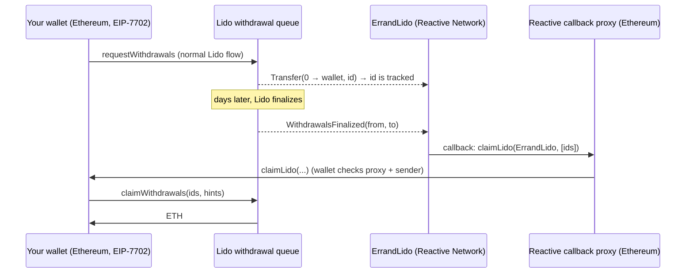
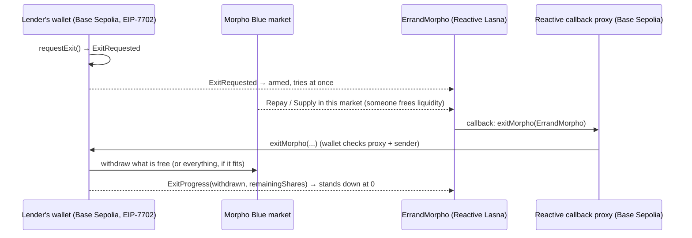

# Errand: your wallet sends its own follow-up transactions the moment they can succeed

Some transactions can only be sent later: claiming a Lido withdrawal once Lido finalizes it, or
withdrawing from a lending market once a borrower repays. Today you have to notice and come back. With
Errand, your own wallet sends that transaction for you, triggered by the event that makes it possible.
It uses one EIP-7702 signature: no bot, no server, no key handed over, and your address doesn't change.

Two errands are built:

1. **[Lido claim](#errand-1-claim-lido-withdrawals-set-it-and-forget-it)** (Ethereum mainnet): claims your finalized Lido withdrawals.
2. **[Morpho exit](#errand-2-get-out-of-a-fully-borrowed-morpho-market-every-second-counts)** (Base Sepolia): gets you out of a 100%-borrowed lending market, one repayment at a time.
   [Measured](#latency-measured-on-base-sepolia) over 30 full loops: the withdrawal lands **3–8 Base blocks (0.6–1.6 s; median 1.0 s, p95 1.6 s)** after the event that triggered it.

**Try it live: [errand.nerom.site](https://errand.nerom.site).** A lender's money is stuck in a fully borrowed market. Deposit some test tUSD with one transaction, and time how fast their wallet takes it back. The page reads every number from the chains.

**Built at:** [Reactive Omni Buildathon](https://dorahacks.io/hackathon/reactive-omni-buildathon/detail), Nov 5 – Dec 5, 2026 · **Tracks:** Set It and Forget It (Lido), Every Second Counts (Morpho) · **Video:** not recorded yet · **Judges:** [check it in 2 minutes](JUDGES.md)

**Proof so far:**
- **Morpho exit:** the full loop has run 30 times on Base Sepolia and Lasna (7 in a scripted race, 23 more against the live demo), with every transaction in [evidence/](evidence/). [ErrandMorpho on Lasna](https://lasna.reactscan.net/address/0x6fBf9C16ed3e75eDA1b5A8Cc600cbA25B1226651) is verified ([Sourcify](https://repo.sourcify.dev/5318007/0x6fBf9C16ed3e75eDA1b5A8Cc600cbA25B1226651)). The wallet got all 100 tUSD out of a fully borrowed market, and then Errand switched itself off.
- **Lido claim:**
  - Live: the reactive contract is on Reactive mainnet and its source is verified ([ErrandLido on Reactscan](https://reactscan.net/address/0x6fBf9C16ed3e75eDA1b5A8Cc600cbA25B1226651), [deploy tx](https://reactscan.net/tx/0xbde3b9c8503df076eb9f883ac82b19314ab772f650d997a76c524308d5905c6b), [Sourcify exact match](https://repo.sourcify.dev/1597/0x6fBf9C16ed3e75eDA1b5A8Cc600cbA25B1226651)).
  - Live: the wallet is delegated to ErrandWallet on Ethereum ([delegation tx](https://etherscan.io/tx/0x4c2d10d363da3b30f678e126e20b7b02ba2549856e457991c1d3cc37124a4910)) and has a real Lido withdrawal request (#142667) that ErrandLido is tracking.
  - Waiting: the first real claim, which fires once Lido finalizes that request (see [What's real](#whats-real)).
  - Tested: the full loop already runs in CI, against real Lido data on a mainnet fork.

The two reactive contracts have the same address on two different networks, Reactive mainnet and Lasna.
That's because both were the first deployment from the same wallet. Lasna is chain 5318007 and mainnet is chain 1597.

## For judges: verify in 2 minutes

No wallet, key or `.env` needed. You need [Foundry](https://getfoundry.sh) and python3.

| Do this | You see |
|---|---|
| `./tools/check-live.sh` | PASS / FAIL / WAIT for every onchain claim in this README, read live from Reactive mainnet, Lasna, Ethereum, Base Sepolia and Sourcify (today: 24 pass, 0 fail, 1 waiting: Lido hasn't finalized our request yet) |
| `ETHEREUM_RPC_URL=https://ethereum-rpc.publicnode.com BASE_SEPOLIA_RPC_URL=https://sepolia.base.org forge test` | 42 tests pass. 10 run on an Ethereum mainnet fork against Lido's real queue, and 9 on a Base Sepolia fork against real Morpho Blue, all with real EIP-7702 delegations. Without the RPC variables, the fork tests are skipped |
| `ETHEREUM_RPC_URL=https://ethereum-rpc.publicnode.com forge test --mt test_fullLoop_reactive -vvv` | Lido events go into the real `ErrandLido`, and its callback payload claims a real finalized request on Ethereum for exactly the ETH Lido owes |
| [errand.nerom.site](https://errand.nerom.site) | The lender's live position, Errand's status, and the latest 12 rounds, read from Lasna and Base Sepolia. With a browser wallet and a little Base Sepolia ETH you can run a round yourself |
| [evidence/race-2026-11-24.json](evidence/race-2026-11-24.json) | The Morpho exit, live: 7 rounds of trigger tx → Lasna reactive tx → Base callback tx, with blocks, timestamps, amounts and fees |
| [evidence/rounds-2026-11-25.json](evidence/rounds-2026-11-25.json) | 20 more rounds against the live demo, the same fields for each, plus min / median / p95 / max over all 30 |
| `cast call 0x6fBf9C16ed3e75eDA1b5A8Cc600cbA25B1226651 "tracked()(uint256[])" -r https://mainnet-rpc.rnk.dev/` | The Lido requests the live contract is waiting on for the wallet |
| `python3 tools/measure-unclaimed.py` | The problem in numbers, measured live (below) |

## Errand 1: claim Lido withdrawals (Set It and Forget It)

### The problem

Lido withdrawals take two transactions: you request, then once Lido finalizes the request you claim.
Nothing claims for you, so finalized ETH just sits there. On Nov 24, 2026
([evidence/lido-unclaimed-2026-11-24.json](evidence/lido-unclaimed-2026-11-24.json), from
[tools/measure-unclaimed.py](tools/measure-unclaimed.py)):

- **37,306 ETH** was held by Lido's queue for requests that are finalized but not claimed (`getLockedEtherAmount()`).
- Of the last 2,000 finalized requests, **542 (27%) were still unclaimed**, holding 16,545 stETH.
- Those unclaimed requests were made a median of **7.6 days** earlier, and the oldest **21.6 days** earlier.

Today the fixes are a reminder, a keeper bot that holds your key, or moving your funds into someone
else's contract. Errand needs none of these: the wallet itself does the claim.

### How it works



1. **The wallet opts in once.** It signs an EIP-7702 authorization pointing at its own
   [`ErrandWallet`](src/ErrandWallet.sol) code ([script/deploy-ethereum.sh](script/deploy-ethereum.sh)).
   The address, key and balance stay the same.
2. **[`ErrandLido`](src/ErrandLido.sol) on Reactive Network watches Lido's queue on Ethereum.** It has
   three subscriptions: request NFTs moving into the wallet, NFTs leaving it, and every
   `WithdrawalsFinalized` ([`src/ErrandLido.sol:61`](src/ErrandLido.sol#L61-L63)).
3. **Tracking.** A request minted or sent to the wallet is tracked, and one that leaves is dropped
   ([`src/ErrandLido.sol:82`](src/ErrandLido.sol#L82-L87)). Claiming burns the NFT, so a claim also drops it.
4. **Lido finalizes.** On `WithdrawalsFinalized`, ErrandLido picks the tracked ids that are now
   finalized (ascending, at most 20) and requests a callback to the wallet itself
   ([`src/ErrandLido.sol:89`](src/ErrandLido.sol#L89-L92), [143-166](src/ErrandLido.sol#L143-L166)).
5. **The wallet claims.** `claimLido` accepts the call only from Reactive's callback proxy, and only
   if Reactive says our ErrandLido sent it. It re-checks each id with Lido, skips anything not claimable,
   computes the checkpoint hints and calls `claimWithdrawals`. The ETH lands in the wallet
   ([`src/ErrandWallet.sol:61`](src/ErrandWallet.sol#L61-L86)).
6. **Fees.** Reactive charges the delivery fee in ETH by calling `pay()` on the wallet, capped per call
   ([`src/ErrandWallet.sol:91`](src/ErrandWallet.sol#L91-L106)). ErrandLido pays its own Reactive fees in
   REACT from its balance.

### Claims (every one checkable today)

| Claim | Where in code | Check |
|---|---|---|
| The wallet keeps its address. It runs ErrandWallet code through an EIP-7702 delegation | [script/deploy-ethereum.sh](script/deploy-ethereum.sh) | `test_walletIsDelegatedAndKeepsItsAddress` ([`test/ErrandWallet.fork.t.sol:78`](test/ErrandWallet.fork.t.sol#L78)) |
| Only Reactive's callback proxy can call `claimLido` and `pay` | [`src/ErrandWallet.sol:52`](src/ErrandWallet.sol#L52-L53) | `test_rejectsAnyCallerButTheProxy` (fork test :96) |
| Only this wallet's own ErrandLido can trigger a claim. Reactive injects the requesting contract as the first argument | [`src/ErrandWallet.sol:62`](src/ErrandWallet.sol#L62), [`src/ErrandLido.sol:163`](src/ErrandLido.sol#L163) | `test_rejectsErrandsFromOtherReactiveContracts` (fork test :103) |
| The delegated code can only claim Lido withdrawals to the wallet itself and pay capped fees. It can't move the wallet's other funds | [`src/ErrandWallet.sol:61`](src/ErrandWallet.sol#L61-L106) | Read the file: its only external calls are Lido's queue and the proxy's `pay` |
| A claim gets exactly the ETH Lido owes | [`src/ErrandWallet.sol:83`](src/ErrandWallet.sol#L83-L86) | `test_errandFromTheProxyClaimsToTheWallet` (fork test :84) |
| Ids that aren't claimable are skipped, so a stale or duplicate errand costs only gas | [`src/ErrandWallet.sol:71`](src/ErrandWallet.sol#L71-L75) | `test_skipsWhatIsNotClaimableAndClaimsTheRest`, `test_duplicateErrandCostsNothingButGas` |
| Fees are capped per payment (0.001 ETH in the deploy script) | [`src/ErrandWallet.sol:102`](src/ErrandWallet.sol#L102) | `test_feesAreCappedPerPayment` (fork test :135) |
| The reactive contract does the tracking and the timing: subscriptions, state and the callback all live in `react()` | [`src/ErrandLido.sol:61`](src/ErrandLido.sol#L61-L63), [72-94](src/ErrandLido.sol#L72-L94) | `test_subscribesToTheWalletsRequestsAndToFinalization`, `test_newRequestIsTrackedAndClaimedWhenLidoFinalizesIt` |
| A failed claim is retried at the next finalization, because ids are only dropped when their NFT leaves the wallet | [`src/ErrandLido.sol:86`](src/ErrandLido.sol#L86-L87) | `test_failedClaimIsRetriedOnTheNextFinalization` (unit test :126) |
| A request sent to the wallet after it was finalized is claimed straight away | [`src/ErrandLido.sol:85`](src/ErrandLido.sol#L85) | `test_requestTransferredInThatIsAlreadyFinalizedIsClaimedRightAway` |
| At most 20 requests per callback, ascending (Lido requires sorted ids) | [`src/ErrandLido.sol:23`](src/ErrandLido.sol#L23), [145](src/ErrandLido.sol#L145) | `test_batchIsCapped`, `test_idsAreSentAscendingAndOnlyFinalizedOnes` |
| The whole loop works with the real contracts and real Lido state | both contracts | `test_fullLoop_reactiveContractPayloadClaimsOnEthereum` (fork test :173) |
| ErrandLido is live on Reactive mainnet, verified, funded and debt-free | [deployments/mainnet.json](deployments/mainnet.json) | `./tools/check-live.sh` |

## Errand 2: get out of a fully borrowed Morpho market (Every Second Counts)

### The problem

When every coin in a lending market is lent out, its lenders can't withdraw. Morpho Blue rejects the
withdrawal with "insufficient liquidity" (`test_theProblem_lenderCannotWithdrawFromAFullyBorrowedMarket`,
[`test/ErrandMorphoWallet.fork.t.sol:92`](test/ErrandMorphoWallet.fork.t.sol#L92)). Each repayment or new
deposit frees some liquidity, and the first lender to send a withdrawal gets it. A lender who wants out
has to keep watching, or run a bot that holds their key.

### How it works



1. **The lender asks once.** The wallet sends `requestExit()` to itself. Only the wallet can do this,
   because the delegated code requires `msg.sender == address(this)`
   ([`src/ErrandMorphoWallet.sol:93`](src/ErrandMorphoWallet.sol#L93)).
2. **[`ErrandMorpho`](src/ErrandMorpho.sol) subscribes to five events**, all filtered to this one market.
   Two are Morpho's `Repay` and `Supply`; three are the wallet's `ExitRequested`, `ExitCancelled` and
   `ExitProgress` ([`src/ErrandMorpho.sol:63`](src/ErrandMorpho.sol#L63-L67)).
   - `ExitRequested` arms it, and it tries right away.
   - While armed, every repay or deposit in the market sends an errand. The wallet's own deposits are skipped.
   - It stands down when `ExitProgress` reports no shares left, or when the wallet cancels
     ([`src/ErrandMorpho.sol:75`](src/ErrandMorpho.sol#L75-L95)).
3. **The wallet withdraws what it can.** `exitMorpho` accepts the call only from Reactive's callback
   proxy, and only when the sender is our ErrandMorpho ([`src/ErrandMorphoWallet.sol:106`](src/ErrandMorphoWallet.sol#L106-L131)).
   - If its whole position fits in the free liquidity, it withdraws everything.
   - Otherwise it withdraws exactly what is free.
   - If nothing is free, it withdraws 0 instead of reverting.
4. **Fees** are paid in ETH through `pay()`, capped per call, the same way as the Lido errand.

### Latency, measured on Base Sepolia

[tools/race.py](tools/race.py) set up a real Morpho Blue market on Base Sepolia, then ran the full loop live:
- The wallet lent 100 tUSD, and a borrower borrowed all of it.
- The wallet asked to exit.
- The borrower repaid in parts, and someone else deposited.

Every transaction is onchain. Evidence: [evidence/race-2026-11-24.json](evidence/race-2026-11-24.json).

| Trigger | Trigger tx (Base) | Reactive tx (Lasna) | Callback tx (Base) | tUSD out | Timestamp Δ | Base blocks | Wall clock |
|---|---|---|---|---|---|---|---|
| requestExit | [0x72bffcf7…](https://base-sepolia.blockscout.com/tx/0x72bffcf77bae7287732af2281b97e6023a218670ad02d2b1962467a1030d477b) | [0xed7146e1…](https://lasna.reactscan.net/tx/0xed7146e13357b8ba5954a508a410041168d0655943c9f4937fb41071589d71a9) | [0xc587602b…](https://base-sepolia.blockscout.com/tx/0xc587602b0c07bcd277c9c514ef95b47299f1dcfcec6c83687d40a24ba2480155) | 0 (nothing free yet) | 1 s | 6 (1.2 s) | 2.67 s |
| repay 10 | [0x02df3310…](https://base-sepolia.blockscout.com/tx/0x02df331060a1e727429d94a3ac4c545f2ce6865f6ad5c13f41afafdf6e73c69b) | [0x22c12746…](https://lasna.reactscan.net/tx/0x22c127463641ef5c660c25912e2a99748c133bc0ce8c2cd5ba58472773712811) | [0xa71e9fd0…](https://base-sepolia.blockscout.com/tx/0xa71e9fd069d2554ee539e42ddb01800c8e056c81a4ccf9b147349abbfeeefcf5) | 10 | 1 s | 3 (0.6 s) | 1.79 s |
| repay 15 | [0x63913582…](https://base-sepolia.blockscout.com/tx/0x63913582a2e3babb00b240b9eb5bac091d00f2778605fb235d08933947ed0b4e) | [0xd288223a…](https://lasna.reactscan.net/tx/0xd288223ac983c47bdc09e87f2a44f933f84502e4ed089911e563a9887ea6b8c0) | [0x8408413e…](https://base-sepolia.blockscout.com/tx/0x8408413e300f446abbddb69e04f7929131ed23d15057c1b39345531f9f25dfe6) | 15 | 1 s | 3 (0.6 s) | 2.35 s |
| repay 20 | [0xe613bab5…](https://base-sepolia.blockscout.com/tx/0xe613bab578062e9cbbdec32d386668a605c91ba415d76fff771a6c15f6dd3e1d) | [0x0fceae49…](https://lasna.reactscan.net/tx/0x0fceae490d723f60c09098602f42e8a0b1c4c93b9a677e1e8d7f484908968a16) | [0x00acbc65…](https://base-sepolia.blockscout.com/tx/0x00acbc65beea1d8569d707194c1cb73b92ee9ddb3859d747b79fd3d81858b312) | 20 | 1 s | 5 (1.0 s) | 2.17 s |
| repay 25 | [0x8028164d…](https://base-sepolia.blockscout.com/tx/0x8028164dee4309ec76c7bdd69c5df5a26871e9735c22f6dd8b5ac1349bae4bb8) | [0x44fb77a3…](https://lasna.reactscan.net/tx/0x44fb77a307984ec361da01dda626681fcef76c8fa58afcf94880a979599ae888) | [0x492b21ec…](https://base-sepolia.blockscout.com/tx/0x492b21ecaf1e1661ed3054bbd195900661004b62815ed7d9a30ba672271ccbca) | 25 | 1 s | 3 (0.6 s) | 2.70 s |
| deposit 10 (another lender) | [0x6beffb13…](https://base-sepolia.blockscout.com/tx/0x6beffb132114d2c6c49a091a101435503ff73c98c159b4ea8444db58b9f1b492) | [0x3b457217…](https://lasna.reactscan.net/tx/0x3b45721798e7ca849d5ce22b2c1ed7e6781e8176455f63e6ffb3a8eb834d34de) | [0x54f0bcc8…](https://base-sepolia.blockscout.com/tx/0x54f0bcc8f4f98737aa3d23d94e5da86db8375b90d3e6e2bf33ae2aabfedf6770) | 10 | 1 s | 6 (1.2 s) | 2.36 s |
| repay rest | [0x7e760c45…](https://base-sepolia.blockscout.com/tx/0x7e760c453b31325e430f5e938bb462b691a4906f030c00c55bbf9abbd8997262) | [0x7fe2c770…](https://lasna.reactscan.net/tx/0x7fe2c770033386be8ade5c1ba8ce3b558157e31f1700e82a43473821aa5c00cb) | [0xdcb45497…](https://base-sepolia.blockscout.com/tx/0xdcb454971c5215e04d576be777ae40cff19db41da2080b618707ab64d1b9ed89) | 20 (all out) | 1 s | 5 (1.0 s) | 2.63 s |

How to read the columns:
- **Timestamp Δ** is the callback block's timestamp minus the trigger block's, as the event rules ask
  for on Base Sepolia. Timestamps have 1-second resolution, and in these 7 rounds the callback landed one
  timestamp second later every time.
- **Base blocks** is the finer measure. Base Sepolia makes a block every 0.2 s (1,000 blocks in 200 s
  when measured). Across the 6 withdrawals it was 3–6 blocks, median 4: **0.6–1.2 s** (median 0.8 s).
- **Lasna timestamps** can't be compared with Base's: Lasna's clock read 1 s *before* the Base trigger in 5 of
  the 7 rounds, so we only time the loop on Base, where it starts and ends.
- **Wall clock** is what [tools/race.py](tools/race.py) saw, from seeing the trigger's receipt to seeing
  the callback's event. It polls a public RPC every 0.4 s, so it adds RPC delay: 1.8–2.7 s.

After the last repay, the wallet held no shares, and ErrandMorpho switched itself off
([disarm tx](https://lasna.reactscan.net/tx/0xcda3ebb2283799e80c429a78d9b73605c3dcc940199a4c50db50e3e3efa21675),
`armed() == false`).

#### 23 more rounds against the live demo

After the race we re-armed the demo for the live page with
[script/testnet/rearm-demo.sh](script/testnet/rearm-demo.sh) and ran 23 more full loops against it. All were
sent by us, not by outside visitors:
- Three one-off rounds: the lender's exit request (4 blocks), a 10 tUSD deposit that the live page followed
  (8 blocks: [trigger](https://base-sepolia.blockscout.com/tx/0x0c6507b5c512c57f6b56ca7504b331bda43c2be03a9ae0aed9f616165873e6c2) → [Lasna](https://lasna.reactscan.net/tx/0xdcecb9089f651a65cd861b03894a9a2c0900215566379304e64b510f57c2a834) → [callback](https://base-sepolia.blockscout.com/tx/0x94cd802ae8c8b9425a76fe523b2b3c0ca34ece8576494dd3a193a21a212cbdd1)),
  and the deposit made from the page for the demo video (5 blocks).
- 20 rounds in a row from [tools/rounds.py](tools/rounds.py), 8 s apart. They alternate a 10 tUSD deposit
  through DemoDeposit (the contract the page's button calls) with a 10 tUSD repay from our test borrower.
  Every callback withdrew exactly 10 tUSD for the lender. Evidence:
  [evidence/rounds-2026-11-25.json](evidence/rounds-2026-11-25.json), with the trigger, Lasna and callback tx
  of each round (the first: [trigger](https://base-sepolia.blockscout.com/tx/0x58960f78a4faac2940c40e261a749230eb8857ab89f1c7585f4bfbbe5a0a91de) → [Lasna](https://lasna.reactscan.net/tx/0xfd0741e254d7da1ff49cf1ceb506f052c7b26354bfb4e6282468034b3a5db509) → [callback](https://base-sepolia.blockscout.com/tx/0x8d80a8679a647a5fcad2b0837519137994715ff292803dfc75e8b4cac169f2db)).

All 30 loops, each timed from the trigger's Base block to the callback's:

| | Min | Median | p95 | Max |
|---|---|---|---|---|
| Base blocks | 3 | 5 | 8 | 8 |
| Seconds, at 0.2 s per block | 0.6 | 1.0 | 1.6 | 1.6 |
| Timestamp Δ (whole seconds) | 0 | 1 | 2 | 2 |

- p95 is nearest-rank. A timestamp Δ of 0 means the trigger and the callback fell in the same second.
- The script's wall clock (trigger receipt seen → callback event seen, polling a public RPC) was 2.5–4.6 s
  in the 20 rounds, median 3.2 s. Most of that is RPC delay.
- Each callback cost the wallet about 0.0000009 ETH in Reactive fees and 120–123k gas.
- The [live page](https://errand.nerom.site) shows the latest 12 rounds and their median, read live from the
  chains, so a visitor's round appears there too. Over just those 12 the median is higher (1.2 s on Nov 25).

**Why this needs Omni:** the lender's own address withdraws within about a second of the event that
freed the money. No bot holds the lender's key, and no server polls Morpho. A lender doing this by hand
competes with every other lender in the market. A keeper would need the key or a vault.

### Claims (Morpho exit)

| Claim | Where in code | Check |
|---|---|---|
| A fully borrowed market rejects withdrawals (the problem is real) | Morpho Blue | `test_theProblem_lenderCannotWithdrawFromAFullyBorrowedMarket` ([`test/ErrandMorphoWallet.fork.t.sol:92`](test/ErrandMorphoWallet.fork.t.sol#L92)) |
| A partial repay is withdrawn exactly, and the rest stays in the market | [`src/ErrandMorphoWallet.sol:119`](src/ErrandMorphoWallet.sol#L119-L127) | `test_errandTakesWhatARepayFreedAndKeepsTheRestIn` (:103), live rounds above |
| With nothing free, the errand withdraws 0 instead of reverting | [`src/ErrandMorphoWallet.sol:123`](src/ErrandMorphoWallet.sol#L123) | `test_nothingFreeMeansAnEmptyAttemptNotARevert` (:128), live round `requestExit` |
| Only the proxy, and only our ErrandMorpho, can make the wallet withdraw | [`src/ErrandMorphoWallet.sol:106`](src/ErrandMorphoWallet.sol#L106-L107) | `test_onlyTheProxyAndOnlyOurErrand` (:134) |
| Only the wallet can start or cancel an exit | [`src/ErrandMorphoWallet.sol:93`](src/ErrandMorphoWallet.sol#L93-L101) | `test_onlyTheWalletCanAskToExit` (:145) |
| Every repay or deposit while armed sends an errand; the wallet's own deposit doesn't | [`src/ErrandMorpho.sol:78`](src/ErrandMorpho.sol#L78-L82) | `test_everyRepayOrSupplyWhileArmedSendsAnErrand`, `test_theWalletsOwnSupplyIsNotLiquidity` |
| Errand stands down when the wallet is fully out | [`src/ErrandMorpho.sol:90`](src/ErrandMorpho.sol#L90-L92) | `test_partialProgressStaysArmedAndFullExitDisarms`, live: `./tools/check-live.sh` |
| The whole loop works with real Morpho events | both contracts | `test_fullLoop_realMorphoEventsDriveTheExit` (:160), and live on testnet |

## Judging criteria

| Criterion (quoted from the event page) | Where we meet it |
|---|---|
| **Execution:** "Does it run? We want to see the reactive transactions and the callbacks they trigger on-chain." | Morpho exit: 30 full loops onchain, each with the trigger tx and Base callback tx (and, for 27, the Lasna reactive tx) in the [latency section](#latency-measured-on-base-sepolia) and [evidence/](evidence/). Lido claim: ErrandLido is live on Reactive mainnet, the wallet is delegated on Ethereum, and ErrandLido picked up its real Lido request ([Tracking event](https://reactscan.net/tx/0x07116c760fe004f14a6c50defcc2effc6179aff81666b26372910e9f72ca0415)). The first claim waits for Lido to finalize it ([What's real](#whats-real)) |
| **Integration:** "Does the reactive contract do real work, or is it bolted on?" | The reactive contracts hold the state and decide when to act. ErrandLido tracks the wallet's requests, waits for finalization and batches the claims ([`src/ErrandLido.sol:72`](src/ErrandLido.sol#L72-L94)). ErrandMorpho arms on request, fires on every repay or deposit, and stands down when the wallet is out ([`src/ErrandMorpho.sol:75`](src/ErrandMorpho.sol#L75-L95)). Without them, nothing knows when to act |
| **Usefulness:** "Does it solve a problem real users have?" | 37,306 ETH is finalized but unclaimed in Lido's queue right now ([measured](#the-problem)). Lenders in a fully borrowed market can't withdraw until someone repays, and then they race for it |
| **Craft:** "Readable code, a working demo, and documentation someone else could follow." | Four small contracts, 42 tests (19 on mainnet and Base Sepolia forks), claims tables with file:line, `./tools/check-live.sh` (24 PASS) and two evidence files covering all 30 rounds |
| **Set It and Forget It:** "a tool you'd actually keep running", "a clear personal purpose" | Turn it on once. After that, each Lido withdrawal the wallet makes is claimed without the owner |
| **Every Second Counts:** "withdrawal queues that settle the moment they can", "latency numbers for the full loop" | The lender's withdrawal lands 3–8 Base blocks after each trigger over 30 rounds (0.6–1.6 s; median 1.0 s, p95 1.6 s), with timestamps and tx links for every round in [evidence/](evidence/), and the latest ones on the live page ([latency](#latency-measured-on-base-sepolia)) |

## What's real

| Part | Status | Proof |
|---|---|---|
| `ErrandLido` | **live on Reactive mainnet**, source verified | [0x6fBf…6651](https://reactscan.net/address/0x6fBf9C16ed3e75eDA1b5A8Cc600cbA25B1226651) · [deploy tx](https://reactscan.net/tx/0xbde3b9c8503df076eb9f883ac82b19314ab772f650d997a76c524308d5905c6b) · [Sourcify](https://repo.sourcify.dev/1597/0x6fBf9C16ed3e75eDA1b5A8Cc600cbA25B1226651) |
| `ErrandWallet` + 7702 delegation on Ethereum | **live**, source verified | [0x08e2…9f05](https://etherscan.io/address/0x08e2A31B676214E306F78aF5Ad1Aa3883eDe9f05) · [deploy tx](https://etherscan.io/tx/0xa04feebfafe7a059d711c44c23b84b8fa6b942c25db40fc578a60f999ca7dbd5) · [delegation tx](https://etherscan.io/tx/0x4c2d10d363da3b30f678e126e20b7b02ba2549856e457991c1d3cc37124a4910) · [Sourcify](https://repo.sourcify.dev/1/0x08e2A31B676214E306F78aF5Ad1Aa3883eDe9f05). Sent by [script/when-gas-is-cheap.sh](script/when-gas-is-cheap.sh) at a 0.07 gwei base fee, because the wallet only had 0.00049 ETH |
| A real Lido request, tracked by ErrandLido | **live** | Request #142667 for 0.000299 ETH: [stake tx](https://etherscan.io/tx/0xb21c8115f5cd7acedf44e41fe61c141bd3da962fcf1edd9153d0979395c2e8be) · [request tx](https://etherscan.io/tx/0xf2687d9ff17d8e2c465539feb09f233fc094416bef4a1ee0a62c1efd848cb237) · [ErrandLido's Tracking event](https://reactscan.net/tx/0x07116c760fe004f14a6c50defcc2effc6179aff81666b26372910e9f72ca0415) |
| That request claimed by Errand on mainnet | **not yet** | Fires when Lido finalizes request #142667 (Lido finalizes about once a day; on Nov 25 its queue was finalized up to #142469) |
| Full loop on a mainnet fork | real Lido queue, real 7702 delegation, simulated delivery | The fork test calls the wallet as the proxy, with the payload ErrandLido produced. Reactive's sender injection is reproduced in [`test/ErrandWallet.fork.t.sol:207`](test/ErrandWallet.fork.t.sol#L207-L211) |
| `ErrandMorpho` | **live on Lasna testnet**, source verified | [0x6fBf…6651 on Lasna](https://lasna.reactscan.net/address/0x6fBf9C16ed3e75eDA1b5A8Cc600cbA25B1226651) · [deploy tx](https://lasna.reactscan.net/tx/0xac1ae838e16484f14f66c3a1f5489c4750d16b84e2ede146031671695127957b) · [Sourcify](https://repo.sourcify.dev/5318007/0x6fBf9C16ed3e75eDA1b5A8Cc600cbA25B1226651) |
| `ErrandMorphoWallet` + 7702 delegation on Base Sepolia | **live**, source verified | [code](https://base-sepolia.blockscout.com/address/0x0D671866021CE29099F9aEc9bfF2d93D6C155CBe) · [Sourcify](https://repo.sourcify.dev/84532/0x0D671866021CE29099F9aEc9bfF2d93D6C155CBe) · [delegation tx](https://base-sepolia.blockscout.com/tx/0xe871ea1446af4546c39cc31ac37887c196caa8f316f023582780852ced597dba) |
| `DemoDeposit` (the live page's deposit button) | **live on Base Sepolia**, source verified | [0x6D05…F648](https://base-sepolia.blockscout.com/address/0x6D05eac4aDEA141AC9fa39fED6C1Bc896873F648) · [Sourcify](https://repo.sourcify.dev/84532/0x6D05eac4aDEA141AC9fa39fED6C1Bc896873F648). One tx mints test tUSD and supplies it to the market on the visitor's behalf (at most 50) |
| Morpho exit, full loop | **ran 7 times on testnet**, real Reactive delivery | [latency table](#latency-measured-on-base-sepolia), [evidence/race-2026-11-24.json](evidence/race-2026-11-24.json) |
| Morpho Blue | **real** Base Sepolia deployment `0xBBBB…FFCb` | [market creation tx](https://base-sepolia.blockscout.com/tx/0xb11ab528f76caf74a6ad2f99a037bbd42fe5a35a2c1cf2b8072f2468af4239bf) |
| tUSD, tETH and the price oracle | **testnet stand-ins we deployed**: open-mint tokens and a fixed 1:1 price | [src/testnet/](src/testnet/), marked testnet-only in the source. Morpho markets are permissionless, so the market is a real one built on them |
| Reactive's system contract in unit tests | simulated: a mock records subscriptions and callbacks | [test/mocks/MockSystem.sol](test/mocks/MockSystem.sol) |

All addresses are in [deployments/mainnet.json](deployments/mainnet.json) and [deployments/testnet.json](deployments/testnet.json). The claim transaction is added here as soon as it lands.

## Why this needs Reactive Network

The claim has to happen on Ethereum, triggered by an Ethereum event, from the user's own address,
without anyone holding the user's key. Without Reactive, that takes a keeper you trust or one you pay
(Gelato, Chainlink Automation) polling around the clock. Reactive's subscriptions turn Lido's own events into
the trigger, and its callback proxy carries an authenticated sender. That second part is what makes
step 5 safe: the wallet can tell its own ErrandLido from anyone else. EIP-7702 makes the user's
wallet a valid callback destination, so no vault or escrow is needed.

The Morpho errand has the same shape on Base Sepolia, with a time limit added: freed liquidity goes to
whichever lender withdraws first, so the callback has to land within seconds, from the lender's own address.

Reactive pieces used: `AbstractReactive` and the system contract's `subscribe` (3 + 5 filters with
`REACTIVE_IGNORE` wildcards), `requestCallbackV_1_0` with per-batch gas, sender injection, `IPayer.pay`
for destination fees, and REACT funding and debt on the reactive side.

## Trust model & limitations

- **Keys:** the user's key stays the only key. Signing a new 7702 authorization (to `address(0)` or
  other code) undoes Errand at any time. ErrandLido's owner is the wallet itself, and owner actions only
  add requests to track, retry a claim, or withdraw the contract's REACT
  ([`src/ErrandLido.sol:102`](src/ErrandLido.sol#L102-L121)). ErrandMorpho's owner is whoever deployed it (the
  wallet, in our deployment). Its only owner action is withdrawing the contract's own REACT
  ([`src/ErrandMorpho.sol:103`](src/ErrandMorpho.sol#L103-L105)); `coverDebt()` is open to anyone, since it only pays Reactive.
- **Trusted:** Reactive Network delivers real Ethereum logs to `react()` and injects the true requesting
  contract into callbacks. If Reactive misbehaved, the worst a forged call could do is claim the wallet's
  own finalized Lido requests to the wallet, and collect fees from the wallet's ETH, at most the cap on each payment.
- **One delegation per wallet:** EIP-7702 allows one delegate at a time, so Errand replaces any other
  7702 code the wallet uses.
- **Wallet support:** the user must sign a 7702 authorization for this code. Today that works with a
  key you control (e.g. Foundry's `cast`). Browser wallets such as MetaMask only delegate to their own
  contracts, so their users can't run Errand yet.
- **Morpho exit:** the reactive contract can only make the wallet withdraw its own position in the one
  market it names, to itself. A forged errand could only withdraw early, which is what the lender asked
  for. Several lenders running Errand on one market would race each other, and the first callback wins.
- **Fee cap is per payment, not a total.** `pay()` refuses any single amount above `MAX_FEE_PER_PAYMENT`
  ([`src/ErrandWallet.sol:101`](src/ErrandWallet.sol#L101)), but nothing limits how many payments the proxy
  asks for. The comment at [`src/ErrandWallet.sol:25`](src/ErrandWallet.sol#L25) says it "bounds what the proxy
  could ever take"; that overstates it. We left the deployed source as it is so it stays verified.
  Only Reactive's callback proxy can call `pay()`, and it charges for callbacks delivered to the wallet.
  We haven't tested whether a different reactive contract could run up those fees by sending the wallet
  callbacks that get rejected. The same applies to the Morpho wallet.
- **Debt above the cap:** `coverDebt()` pays the whole debt in one payment, so if a gas spike ever left
  more than the cap owed, it would revert. Recovery is a new 7702 authorization with a higher cap.
- **Batching:** one callback claims at most 20 requests. Any more wait for the next finalization.
- **Cost:** each claim costs Ethereum gas plus Reactive's fee. For a very small request, the fee can
  be close to the amount claimed. The mainnet test request is deliberately tiny.

## Not built yet

- A setup page, so people can turn Errand on for their own wallet without the command line. Setup is scripts today: browser wallets won't sign an EIP-7702 delegation to outside code yet. The [live page](https://errand.nerom.site) demos the Morpho exit with our demo lender.
- A measured delay from finalization to claim on mainnet. That needs the first real claim.
- Other two-step withdrawals with the same shape (EigenLayer, Ethena cooldowns, Reactive's own staking).
- The Morpho exit on mainnet. Morpho Blue is on Base mainnet, and the same code works there with a real market.
- More than one market per wallet for the Morpho exit. Today, one wallet's code names one market.

## Run it

```bash
git clone --recursive https://github.com/neromtoobad/errand && cd errand
forge test                                   # unit tests; fork tests run when their RPC URLs are set
ETHEREUM_RPC_URL=https://ethereum-rpc.publicnode.com BASE_SEPOLIA_RPC_URL=https://sepolia.base.org forge test
```

To set up Errand for your own wallet (needs REACT on Reactive and a little ETH on Ethereum):

```bash
cp .env.example .env                         # your wallet's address and key
./script/deploy-reactive.sh                  # ErrandLido on Reactive Network (REACT only)
./script/deploy-ethereum.sh                  # ErrandWallet + 7702 delegation (or: ./script/when-gas-is-cheap.sh)
```

To rerun the Morpho exit on testnets (needs about 0.02 Base Sepolia ETH; 0.015 of it becomes lREACT at
Reactive's faucet `0x2afaFD298b23b62760711756088F75B7409f5967`):

```bash
./script/testnet/deploy-morpho.sh            # tokens, market, ErrandMorpho on Lasna, 7702 wallet, lend + borrow
python3 tools/race.py                        # exit request, repays and a deposit, timed; writes evidence/
```

## Built at the event

The first commit is from 2026-11-23, after the event started on Nov 5. All of the code in this repo
was written during the event. The only outside code is in the dependencies:
[forge-std](https://github.com/foundry-rs/forge-std) and
[reactive-lib-omni](https://github.com/Reactive-Network/reactive-lib-omni) v0.1.0, as git submodules in `lib/`.
Some commits are seconds apart: a finished piece of work was committed file by file, so each commit holds one change.

## AI usage

Built with Claude Code. Under our direction, it wrote the contracts, tests, scripts, measurement tool and
this README, and it ran the deployments. We chose the idea, the design and the tradeoffs, funded
the wallet and reviewed the results. No AI runs inside Errand itself.

## Team

[neromtoobad](https://github.com/neromtoobad)
