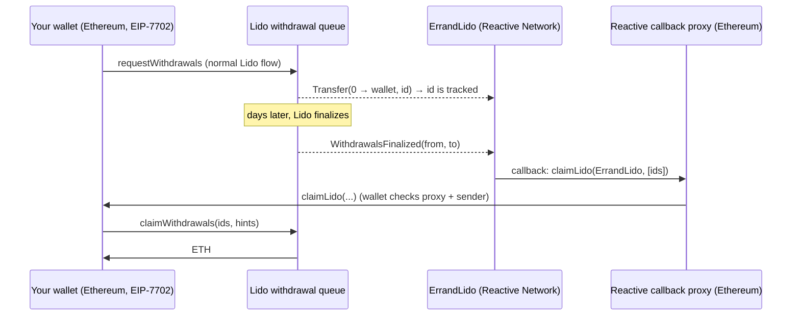

# Errand: your wallet claims its own Lido withdrawals the moment they're ready

You ask Lido for your ETH back, and days later Lido marks the request ready. Today you then have to
notice, come back and send a claim transaction. With Errand, your own wallet sends that claim for you.
It uses one EIP-7702 signature: no bot, no server, no key handed over, and your address doesn't change.

**Built at:** [Reactive Omni Buildathon](https://dorahacks.io/hackathon/reactive-omni-buildathon/detail), Nov 5 – Dec 5, 2026 · **Track:** Set It and Forget It · **Video:** not recorded yet

**Proof so far:** the reactive contract is live on Reactive mainnet and its source is verified
([ErrandLido on Reactscan](https://reactscan.net/address/0x6fBf9C16ed3e75eDA1b5A8Cc600cbA25B1226651),
[deploy tx](https://reactscan.net/tx/0xbde3b9c8503df076eb9f883ac82b19314ab772f650d997a76c524308d5905c6b),
[Sourcify exact match](https://repo.sourcify.dev/1597/0x6fBf9C16ed3e75eDA1b5A8Cc600cbA25B1226651)).
The Ethereum side is waiting for cheap gas (see [What's real](#whats-real)). The full loop already runs
against real Lido data on a mainnet fork, in CI.

## For judges: verify in 2 minutes

No wallet, key or `.env` needed. You need [Foundry](https://getfoundry.sh) and python3.

| Do this | You see |
|---|---|
| `./tools/check-live.sh` | PASS / FAIL / WAIT for every onchain claim in this README, read live from Reactive mainnet, Ethereum and Sourcify |
| `ETHEREUM_RPC_URL=https://ethereum-rpc.publicnode.com forge test` | 22 tests pass. 10 of them run on an Ethereum mainnet fork, against Lido's real queue and a real EIP-7702 delegation (without the variable they're skipped) |
| `ETHEREUM_RPC_URL=https://ethereum-rpc.publicnode.com forge test --mt test_fullLoop -vvv` | Lido events go into the real `ErrandLido`, and its callback payload claims a real finalized request on Ethereum for exactly the ETH Lido owes |
| `cast call 0x6fBf9C16ed3e75eDA1b5A8Cc600cbA25B1226651 "tracked()(uint256[])" -r https://mainnet-rpc.rnk.dev/` | The Lido requests the live contract is waiting on for the wallet |
| `python3 tools/measure-unclaimed.py` | The problem in numbers, measured live (below) |

## The problem

Lido withdrawals take two transactions: you request, then once Lido finalizes the request you claim.
Nothing claims for you, so finalized ETH just sits there. On Nov 24, 2026
([evidence/lido-unclaimed-2026-11-24.json](evidence/lido-unclaimed-2026-11-24.json), from
[tools/measure-unclaimed.py](tools/measure-unclaimed.py)):

- **37,306 ETH** was held by Lido's queue for requests that are finalized but not claimed (`getLockedEtherAmount()`).
- Of the last 2,000 finalized requests, **542 (27%) were still unclaimed**, holding 16,545 stETH.
- Those unclaimed requests were made a median of **7.6 days** earlier, and the oldest **21.6 days** earlier.

Today the fixes are a reminder, a keeper bot that holds your key, or moving your funds into someone
else's contract. Errand needs none of these: the wallet itself does the claim.

## How it works



1. **The wallet opts in once.** It signs an EIP-7702 authorization pointing at its own
   [`ErrandWallet`](src/ErrandWallet.sol) code ([script/deploy-ethereum.sh](script/deploy-ethereum.sh)).
   The address, key and balance stay the same.
2. **[`ErrandLido`](src/ErrandLido.sol) on Reactive Network watches Lido's queue on Ethereum.** It has
   three subscriptions: request NFTs moving into the wallet, NFTs leaving it, and every
   `WithdrawalsFinalized` ([`src/ErrandLido.sol:61`](src/ErrandLido.sol#L61-L63)).
3. **Tracking.** A request minted or sent to the wallet is tracked, and one that leaves is dropped
   ([`src/ErrandLido.sol:82`](src/ErrandLido.sol#L82-L87)). Claiming burns the NFT, so a claim also drops it.
4. **Lido finalizes.** On `WithdrawalsFinalized`, ErrandLido picks the tracked ids that are now
   finalized (ascending, at most 20) and requests a callback to the wallet itself
   ([`src/ErrandLido.sol:89`](src/ErrandLido.sol#L89-L92), [143-166](src/ErrandLido.sol#L143-L166)).
5. **The wallet claims.** `claimLido` accepts the call only from Reactive's callback proxy, and only
   if Reactive says our ErrandLido sent it. It re-checks each id with Lido, skips anything not claimable,
   computes the checkpoint hints and calls `claimWithdrawals`. The ETH lands in the wallet
   ([`src/ErrandWallet.sol:61`](src/ErrandWallet.sol#L61-L86)).
6. **Fees.** Reactive charges the delivery fee in ETH by calling `pay()` on the wallet, capped per call
   ([`src/ErrandWallet.sol:91`](src/ErrandWallet.sol#L91-L106)). ErrandLido pays its own Reactive fees in
   REACT from its balance.

## Claims (every one checkable today)

| Claim | Where in code | Check |
|---|---|---|
| The wallet keeps its address. It runs ErrandWallet code through an EIP-7702 delegation | [script/deploy-ethereum.sh](script/deploy-ethereum.sh) | `test_walletIsDelegatedAndKeepsItsAddress` ([`test/ErrandWallet.fork.t.sol:78`](test/ErrandWallet.fork.t.sol#L78)) |
| Only Reactive's callback proxy can call `claimLido` and `pay` | [`src/ErrandWallet.sol:52`](src/ErrandWallet.sol#L52-L53) | `test_rejectsAnyCallerButTheProxy` (fork test :96) |
| Only this wallet's own ErrandLido can trigger a claim. Reactive injects the requesting contract as the first argument | [`src/ErrandWallet.sol:62`](src/ErrandWallet.sol#L62), [`src/ErrandLido.sol:163`](src/ErrandLido.sol#L163) | `test_rejectsErrandsFromOtherReactiveContracts` (fork test :103) |
| The delegated code can only claim Lido withdrawals to the wallet itself and pay capped fees. It can't move the wallet's other funds | [`src/ErrandWallet.sol:61`](src/ErrandWallet.sol#L61-L106) | Read the file: its only external calls are Lido's queue and the proxy's `pay` |
| A claim gets exactly the ETH Lido owes | [`src/ErrandWallet.sol:83`](src/ErrandWallet.sol#L83-L86) | `test_errandFromTheProxyClaimsToTheWallet` (fork test :84) |
| Ids that aren't claimable are skipped, so a stale or duplicate errand costs only gas | [`src/ErrandWallet.sol:71`](src/ErrandWallet.sol#L71-L75) | `test_skipsWhatIsNotClaimableAndClaimsTheRest`, `test_duplicateErrandCostsNothingButGas` |
| Fees are capped per payment (0.001 ETH in the deploy script) | [`src/ErrandWallet.sol:102`](src/ErrandWallet.sol#L102) | `test_feesAreCappedPerPayment` (fork test :135) |
| The reactive contract does the tracking and the timing: subscriptions, state and the callback all live in `react()` | [`src/ErrandLido.sol:61`](src/ErrandLido.sol#L61-L63), [72-94](src/ErrandLido.sol#L72-L94) | `test_subscribesToTheWalletsRequestsAndToFinalization`, `test_newRequestIsTrackedAndClaimedWhenLidoFinalizesIt` |
| A failed claim is retried at the next finalization, because ids are only dropped when their NFT leaves the wallet | [`src/ErrandLido.sol:86`](src/ErrandLido.sol#L86-L87) | `test_failedClaimIsRetriedOnTheNextFinalization` (unit test :126) |
| A request sent to the wallet after it was finalized is claimed straight away | [`src/ErrandLido.sol:85`](src/ErrandLido.sol#L85) | `test_requestTransferredInThatIsAlreadyFinalizedIsClaimedRightAway` |
| At most 20 requests per callback, ascending (Lido requires sorted ids) | [`src/ErrandLido.sol:23`](src/ErrandLido.sol#L23), [145](src/ErrandLido.sol#L145) | `test_batchIsCapped`, `test_idsAreSentAscendingAndOnlyFinalizedOnes` |
| The whole loop works with the real contracts and real Lido state | both contracts | `test_fullLoop_reactiveContractPayloadClaimsOnEthereum` (fork test :173) |
| ErrandLido is live on Reactive mainnet, verified, funded and debt-free | [deployments/mainnet.json](deployments/mainnet.json) | `./tools/check-live.sh` |

## Judging criteria

| Criterion (quoted from the event page) | Where we meet it |
|---|---|
| **Execution:** "Does it run? We want to see the reactive transactions and the callbacks they trigger on-chain." | ErrandLido is live on Reactive mainnet ([What's real](#whats-real)). The Ethereum side and the first real claim are pending, as listed there. The full loop runs in CI on a mainnet fork |
| **Integration:** "Does the reactive contract do real work, or is it bolted on?" | All tracking, timing and batching happens in `react()` ([`src/ErrandLido.sol:72`](src/ErrandLido.sol#L72-L94)). Without it, nothing knows when to claim |
| **Usefulness:** "Does it solve a problem real users have?" | 37,306 ETH is finalized but unclaimed in Lido's queue right now ([The problem](#the-problem)) |
| **Craft:** "Readable code, a working demo, and documentation someone else could follow." | Two small contracts, 22 tests, a [Claims](#claims-every-one-checkable-today) table with file:line for each claim, and `./tools/check-live.sh` |
| **Set It and Forget It:** "a tool you'd actually keep running", "a clear personal purpose" | Turn it on once. After that, each Lido withdrawal the wallet makes is claimed without the owner |

## What's real

| Part | Status | Proof |
|---|---|---|
| `ErrandLido` | **live on Reactive mainnet**, source verified | [0x6fBf…6651](https://reactscan.net/address/0x6fBf9C16ed3e75eDA1b5A8Cc600cbA25B1226651) · [deploy tx](https://reactscan.net/tx/0xbde3b9c8503df076eb9f883ac82b19314ab772f650d997a76c524308d5905c6b) · [Sourcify](https://repo.sourcify.dev/1597/0x6fBf9C16ed3e75eDA1b5A8Cc600cbA25B1226651) |
| `ErrandWallet` + 7702 delegation on Ethereum | **waiting for cheap gas** | The project wallet has 0.00049 ETH. [script/when-gas-is-cheap.sh](script/when-gas-is-cheap.sh) deploys when the base fee is ≤ 0.12 gwei. A rehearsal on a mainnet fork with that exact balance passed |
| A real Lido request claimed by Errand on mainnet | **not yet** | It follows the step above, after Lido finalizes the request (Lido finalizes about once a day) |
| Full loop on a mainnet fork | real Lido queue, real 7702 delegation, simulated delivery | The fork test calls the wallet as the proxy, with the payload ErrandLido produced. Reactive's sender injection is reproduced in [`test/ErrandWallet.fork.t.sol:207`](test/ErrandWallet.fork.t.sol#L207-L211) |
| Reactive's system contract in unit tests | simulated: a mock records subscriptions and callbacks | [test/mocks/MockSystem.sol](test/mocks/MockSystem.sol) |

This table and `deployments/mainnet.json` get the Ethereum addresses and the claim transaction as soon as they exist.

## Why this needs Reactive Network

The claim has to happen on Ethereum, triggered by an Ethereum event, from the user's own address,
without anyone holding the user's key. Without Reactive, that takes a keeper you trust or one you pay
(Gelato, Chainlink Automation) polling around the clock. Reactive's subscriptions turn Lido's own events into
the trigger, and its callback proxy carries an authenticated sender. That second part is what makes
step 5 safe: the wallet can tell its own ErrandLido from anyone else. EIP-7702 makes the user's
wallet a valid callback destination, so no vault or escrow is needed.

Reactive pieces used: `AbstractReactive` and the system contract's `subscribe` (3 filters with
`REACTIVE_IGNORE` wildcards), `requestCallbackV_1_0` with per-batch gas, sender injection, `IPayer.pay`
for destination fees, and REACT funding and debt on the reactive side.

## Trust model & limitations

- **Keys:** the user's key stays the only key. Signing a new 7702 authorization (to `address(0)` or
  other code) undoes Errand at any time. ErrandLido's owner is the wallet itself, and owner actions only
  add requests to track, retry a claim, or withdraw the contract's REACT
  ([`src/ErrandLido.sol:102`](src/ErrandLido.sol#L102-L121)).
- **Trusted:** Reactive Network delivers real Ethereum logs to `react()` and injects the true requesting
  contract into callbacks. If Reactive misbehaved, the worst a forged call could do is claim the wallet's
  own finalized Lido requests to the wallet, and collect fees from the wallet's ETH, at most the cap on each payment.
- **One delegation per wallet:** EIP-7702 allows one delegate at a time, so Errand replaces any other
  7702 code the wallet uses.
- **Wallet support:** the user must sign a 7702 authorization for this code. Today that works with a
  key you control (e.g. Foundry's `cast`). Browser wallets such as MetaMask only delegate to their own
  contracts, so their users can't run Errand yet.
- **Batching:** one callback claims at most 20 requests. Any more wait for the next finalization.
- **Cost:** each claim costs Ethereum gas plus Reactive's fee. For a very small request, the fee can
  be close to the amount claimed. The mainnet test request is deliberately tiny.

## Not built yet

- A setup page, so people can turn Errand on without the command line. Setup is scripts today.
- A measured delay from finalization to claim on mainnet. That needs the first real claim.
- Other two-step withdrawals with the same shape (EigenLayer, Ethena cooldowns, Reactive's own staking).
- An entry for Every Second Counts (a testnet withdrawal queue with measured latency).

## Run it

```bash
git clone --recursive https://github.com/neromtoobad/errand && cd errand
forge test                                   # unit tests; fork tests run when ETHEREUM_RPC_URL is set
ETHEREUM_RPC_URL=https://ethereum-rpc.publicnode.com forge test
```

To set up Errand for your own wallet (needs REACT on Reactive and a little ETH on Ethereum):

```bash
cp .env.example .env                         # your wallet's address and key
./script/deploy-reactive.sh                  # ErrandLido on Reactive Network (REACT only)
./script/deploy-ethereum.sh                  # ErrandWallet + 7702 delegation (or: ./script/when-gas-is-cheap.sh)
```

## Built at the event

The first commit is from 2026-11-23, after the event started on Nov 5. All of the code in this repo
was written during the event. The only outside code is in the dependencies:
[forge-std](https://github.com/foundry-rs/forge-std) and
[reactive-lib-omni](https://github.com/Reactive-Network/reactive-lib-omni) v0.1.0, as git submodules in `lib/`.

## AI usage

Built with Claude Code. Under our direction, it wrote the contracts, tests, scripts, measurement tool and
this README, and it ran the deployments. We chose the idea, the design and the tradeoffs, funded
the wallet and reviewed the results. No AI runs inside Errand itself.

## Team

[neromtoobad](https://github.com/neromtoobad)
